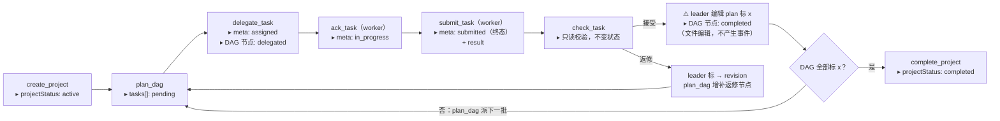
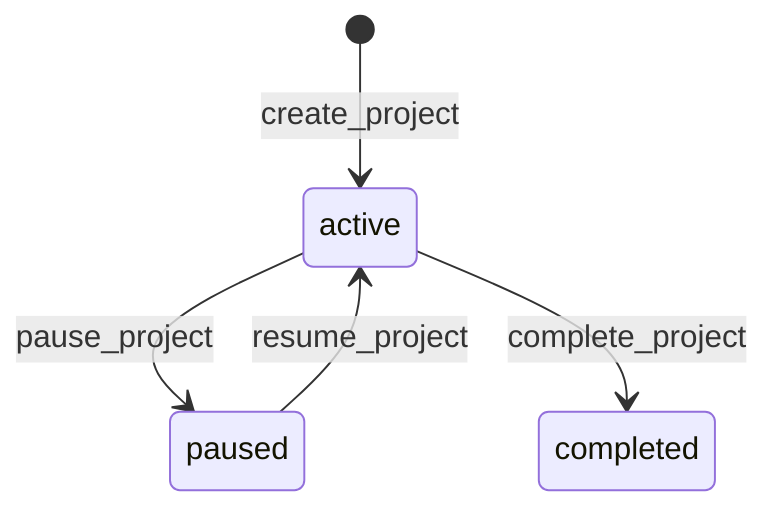
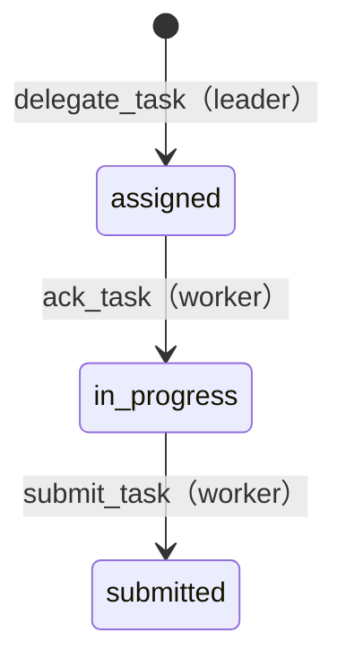
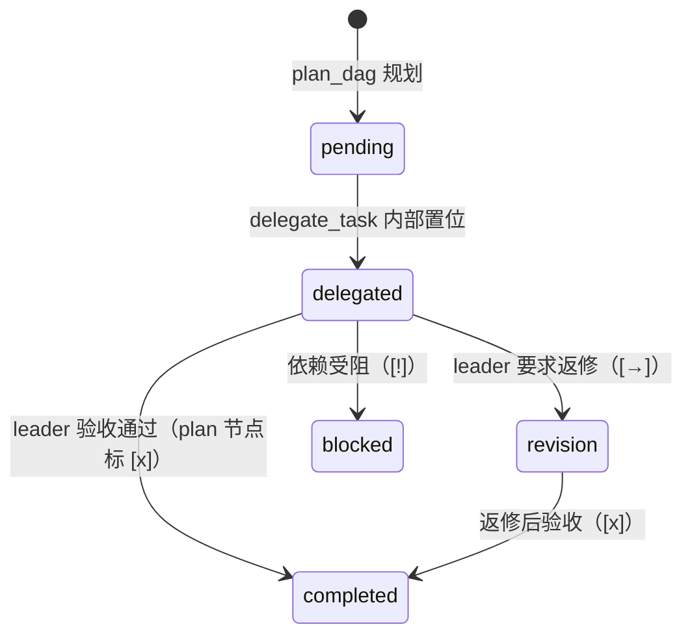

# STATUS_EVENT 状态上报规范（接收方开发依据）

- 版本：v1（与日志版 STATUS_EVENT 同流，信封结构已在 105 实测：t-sr2 混合队 11 事件全绿）
- 发送端代码（两条运行时线，信封字段级兼容，对接收方不区分来源）：
  - copaw 线：`copaw/src/copaw_worker/hooks/tools/status_report.py`（d44280d5）
  - worker-bridge 线：`worker-bridge/cli/{projectflow,taskflow}/status_report.py` + 两份 sandbox 模板拷贝（d4206660）
- 读者：上报接收方（看板/第三方系统）开发者。按本文实现接收端即可，无需读 Matrix 房间或对象存储。

## 0. 状态流转总览（先看这张图）

一次任务协作的完整生命周期与事件点。状态变化用 ▸ 标注；**实线框 = 产生 STATUS_EVENT 的动作**，⚠ = 不产生事件的动作：



读图要点：

- **事件点**：每个实线框对应一类 STATUS_EVENT（§4 全表）；`submit_task` 事件同时携带 `result`（执行人自报结果）。
- **⚠ 验收无事件**：leader 接受结果后手动把 plan.md 节点标记为已完成（DAG 节点轴 → `completed`），这是文件编辑、不是协议工具动作——接收方感知"已验收"只能靠下一次 `plan_dag` 事件的 `tasks[]`（该节点变 completed）或 `complete_project` 到达（§6.3）。
- **`submitted` 是任务终态**：`check_task` 只读，`complete_project` 时 `projectTasks` 全表仍为 `submitted`——接收方的任务状态机以 `assigned → in_progress → submitted` 为准（§6.2）。
- **暂停**：任一时刻 `pause_project`（active→paused，冻结派发）/`resume_project`（回 active），见 §6.1；**阻塞/中断**由 worker 的 `result.status`（BLOCKED/INTERRUPTED）表达，不进任何状态轴（§6.4）。
- 三条状态轴（项目 / 任务实例 / DAG 节点）的字段映射与完整定义见 §6。

## 1. 上报模型

每个**成功的状态变更动作**产生**一个**事件：HTTP POST 单事件单请求，JSON body。只读动作（ready_nodes、ready_loop_nodes、check_active_tasks）不产生事件；`dryRun=true` 或返回 `ok=false` 的动作也不产生事件——**接收方永远不会收到失败/试运行事件**。

同一个事件同时走两个出口（双写）：

1. `kubectl logs` 中 `STATUS_EVENT <json>` INFO 行（永远开启，兜底可追溯）；
2. HTTP POST 到配置的 webhook URL（配置了才发，见 §8）。

## 2. 传输契约

| 项 | 约定 |
|---|---|
| Method / URL | `POST {AGENTTEAMS_STATUS_WEBHOOK_URL}`（发送方配置，任意 http/https URL） |
| Body | 单事件 JSON 对象，UTF-8，`Content-Type: application/json` |
| 鉴权 | 可选 `Authorization: Bearer <token>`（发送方配了 token 才带；接收方建议校验） |
| 发送方超时 | **3 秒**——接收方必须在这个时间内返回 |
| 送达判定 | 任意 **2xx** 即送达；发送方不读 body |
| 重试 | **无重试**。非 2xx / 超时 / 连接失败 → 事件丢弃，仅记一条 WARN 日志 |
| 顺序 | **无顺序保证**。多 pod 并发上报，事件可能乱序到达 |
| 语义 | at-most-once 通知流，不是事务消息。接收方按 §7 幂等收敛 |

**接收方最低要求：3 秒内返回 2xx（先落盘/入队再处理）、幂等 upsert、忽略未知字段。**

## 3. 事件信封（Envelope）

一个事件对象。字段分**必填**（恒在：`event`、`timestamp`）与**可选**两类：可选字段在不适用/未知时**整个键被省略**（JSON 中不出现该键）。键不存在 ≠ null ≠ 空串 ≠ false——接收方不得把省略的键当作空值解读。对象块内部另有显式 `null`（如 `task.submitted_at: null` = 该时刻尚未发生），与键省略语义不同：

| 字段 | 类型 | 语义 |
|---|---|---|
| `event` | string | 事件类型，`<tool>.<action>`，见 §4 |
| `team` | string（可选） | 团队名（Team CR 名） |
| `actor` | string（可选） | 动作执行者的 Matrix user ID（如 `@pl1-lead:matrix-local.agentteams.io:18080`），据此区分 leader/worker |
| `projectId` | string（可选） | 项目 ID，格式 `{description}-YYYYMMDD-HHMMSS` |
| `taskId` | string（可选） | 任务 ID，格式 `{projectId}-{seq}` |
| `taskStatus` | string（可选） | 该任务当前状态（见 §6） |
| `projectStatus` | string（可选） | 该项目当前状态（见 §6） |
| `timestamp` | string | 动作完成时刻，ISO 8601 UTC（`2026-10-23T06:29:32.123456+00:00`）。**各 pod 本地时钟，跨 pod 不可作全序依据** |
| `project` | object | 项目元数据全量，= `shared/projects/<id>/meta.json` 内容，见 §5.1 |
| `task` | object | 任务元数据全量，= `shared/tasks/<id>/meta.json` 内容，见 §5.2 |
| `tasks` | list | plan_dag 规划出的 DAG 节点表，见 §5.3 |
| `readyNodes` | list | 本次规划判定就绪可派的节点（DagTask 结构，同 §5.3） |
| `loop` | object | Loop 计划（plan_loop / record_loop_iteration 事件），见 §5.4 |
| `result` | object | 任务结果（submit_task / check_task 事件），见 §5.5 |
| `projectTasks` | list | **项目任务对账快照**：该项目全部已委派任务的当前状态表，见 §5.6 |

顶层标量（`event/team/actor/projectId/taskId/taskStatus/projectStatus/timestamp`）供快速路由和入库；对象块（`project/task/tasks/readyNodes/loop/result/projectTasks`）是全量元数据，接收方可以直接落库展示，不必回源读共享存储。

## 4. 事件类型（11 种）

| `event` 值 | 触发动作 | 典型发出方 | 特有载荷块 |
|---|---|---|---|
| `projectflow.create_project` | 创建项目 | leader | `project` |
| `projectflow.plan_dag` | 规划 DAG | leader | `tasks` + `readyNodes` + `projectTasks` |
| `projectflow.plan_loop` | 规划 Loop 计划 | leader | `loop` |
| `projectflow.record_loop_iteration` | 记录一次迭代 | leader | `loop` |
| `projectflow.pause_project` | 暂停项目 | leader | `project` |
| `projectflow.resume_project` | 恢复项目 | leader | `project` |
| `projectflow.complete_project` | 完成项目（前置：全部任务 completed） | leader | `project` + `projectTasks` |
| `taskflow.delegate_task` | 委派任务（创建任务 + 房间 @ 通知） | leader | `task` |
| `taskflow.ack_task` | Worker 接单 | worker | `task` |
| `taskflow.submit_task` | Worker 提交结果 | worker | `task` + `result` |
| `taskflow.check_task` | 查验任务结果（只读，不变状态；验收动作本身无事件，见 §6.3） | leader 或 worker | `task` + `result` |

worker-bridge 线的命令名与事件名映射（接收方看到的 event 值两线一致）：

| bridge CLI 命令 | 事件值 |
|---|---|
| `taskflow ack / submit / check` | `taskflow.ack_task / submit_task / check_task` |
| `projectflow create-project / plan-dag / plan-loop / record-iteration` | `projectflow.create_project / plan_dag / plan_loop / record_loop_iteration` |
| `projectflow pause / resume / complete` | `projectflow.pause_project / resume_project / complete_project` |
| `projectflow delegate-commit` | `taskflow.delegate_task` |
| `projectflow check` | `taskflow.check_task` |

## 4A. direct 协作模式事件（2 种）

当 Team CR 设置 `spec.collaboration: direct` 时，该 team 不注册 taskflow/projectflow 工具（§4 的 11 种事件在此类 team 中不会产生），改为由 direct 工作流发出以下两种事件。**两模式按 team 共存，同一事件流中可混合出现；`team` 字段区分来源队。**

| `event` 值 | 触发动作 | 典型发出方 | 特有载荷块 |
|---|---|---|---|
| `direct_work_started` | agent 开始实际工作（长任务鼓励，快任务可省） | worker 或 leader（被 @ 的成员） | `work` |
| `direct_work_completed` | 工作完成（有交付物或最终结论时必发） | 同上 | `work` |

发送入口（direct 模式下的唯一上报通道，均复用 §2 传输契约与 §8 配置解析）：

| 线 | 入口 | 代码 |
|---|---|---|
| copaw | `work_report` 工具（direct 模式注册，替代 taskflow/projectflow） | `copaw/src/copaw_worker/hooks/tools/work_report.py` |
| worker-bridge | `work-report` CLI（direct-work skill） | `worker-bridge/template/worker-bridge-agent/skills/direct-work/scripts/work_report.py` |

### `work` 载荷块

| 字段 | 出现条件 | 含义 |
|---|---|---|
| `summary` | 恒在 | 一句话工作/结果描述 |
| `requester` | 可选 | 发起 @ 的成员 Matrix ID（纯文本，不含矩阵域解析义务） |
| `status` | 仅 completed | `SUCCESS`（默认）/ `SUCCESS_WITH_NOTES` / `BLOCKED`（真阻断；凭据等待按协议是暂停，不报 BLOCKED） |
| `deliverables` | 仅 completed，有交付物时 | 共享相对路径数组，如 `["shared/outputs/pl3-dev/report.md"]`——**接收方可顺此路径到对象存储 `teams/<team>/shared/` 下取结果** |

示例（completed）：

```json
{
  "event": "direct_work_completed",
  "team": "t-pl3",
  "actor": "@pl3-dev:example.org",
  "work": {
    "summary": "构建周报已生成",
    "requester": "@admin:example.org",
    "status": "SUCCESS",
    "deliverables": ["shared/outputs/pl3-dev/build-report.md"]
  },
  "timestamp": "2026-11-09T10:00:00+00:00"
}
```

接收方注意：
- direct 事件**没有** `projectId`/`taskId`/`project`/`task`/`projectTasks` 等任务轴字段（键省略，与 §3 可选字段语义一致）；`event`/`timestamp` 恒在，`team`/`actor` 解析失败时省略。
- direct 工作**不进入 dashboard 项目看板**（看板读 `shared/projects/` meta.json，direct 模式不写该目录）；direct 事件的消费通道是 webhook + 日志。
- 上报语义与任务事件相同：best-effort、at-most-once、3 秒超时、失败仅 WARN；`started` 依赖 agent 自发调用，可能缺席，接收方不得把 `started` 当作 completed 的必需前置。

## 5. 载荷块结构

字段名两线统一（copaw 侧 dataclass 定义，bridge 侧同构 snake_case）。

### 5.1 `project`（ProjectMeta，`copaw/src/copaw_worker/task.py:36`）

```json
{
  "project_id": "manual-20261023-062932",
  "title": "整理术语表与常见问题",
  "status": "active",
  "source": null,
  "requester": "@hdn-alice:matrix-local.agentteams.io:18080",
  "parent_task_id": null,
  "created_at": "2026-10-23T06:29:32+00:00"
}
```

### 5.2 `task`（TaskMeta，`task.py:68`）

```json
{
  "task_id": "manual-20261023-062932-01",
  "project_id": "manual-20261023-062932",
  "task_title": "整理产品术语表",
  "assigned_to": "pl1-dev",
  "room_id": "!xyz:matrix-local.agentteams.io:18080",
  "status": "in_progress",
  "depends_on": [],
  "assigned_at": "2026-10-23T06:30:01+00:00",
  "acknowledged_at": "2026-10-23T06:31:12+00:00",
  "submitted_at": null,
  "event_id": null
}
```

`assigned_to` 是 Worker 的逻辑名（短名，如 `pl1-dev`）——接收方显示"执行人"用这个，不是 `actor`。

### 5.3 `tasks[]` / `readyNodes[]`（DagTask，`task.py:47`）

plan_dag 事件的 DAG 规划结果；`tasks` 是全部节点，`readyNodes` 是本次就绪节点：

```json
{
  "task_id": "manual-20261023-062932-02",
  "title": "编写常见问题解答",
  "assigned_to": "pl1-qa",
  "depends_on": ["manual-20261023-062932-01"],
  "status": "pending"
}
```

### 5.4 `loop`（LoopPlan，`task.py:56`）

```json
{
  "goal": "持续压测直到 30/30 通过",
  "stop_condition": "连续两轮零失败",
  "iteration_template": "第 {n} 轮回归",
  "max_iterations": 5,
  "current_iteration": 2,
  "status": "running",
  "tasks": [],
  "history": ["第 1 轮回归"]
}
```

### 5.5 `result`（TaskResult，`task.py:83`）

```json
{
  "status": "completed",
  "summary": "术语表 12 条已发布 shared/glossary.md",
  "deliverables": ["shared/glossary.md"],
  "notes": []
}
```

### 5.6 `projectTasks[]`（对账快照）

发出事件那一刻、该项目**全部已委派任务**的当前状态表（leader 侧是全量表；worker 侧可能只有本 pod 拉取过的任务——worker 侧该块可能被省略）。**推荐接收方以此块做状态收敛**（见 §7）：

```json
[
  {"taskId": "manual-20261023-062932-01", "title": "整理产品术语表",
   "assignedTo": "pl1-dev", "status": "submitted", "dependsOn": []},
  {"taskId": "manual-20261023-062932-02", "title": "编写常见问题解答",
   "assignedTo": "pl1-qa", "status": "assigned", "dependsOn": ["manual-20261023-062932-01"]}
]
```

`status` 取值 = 任务实例轴（§6.2：`assigned`/`in_progress`/`submitted`）；`completed` 属 DAG 节点轴，不会出现在此字段——105 实测 `complete_project` 时刻全表仍为 `submitted`。`assignedTo` 是 worker 逻辑名（短名），不是 Matrix 全 ID。

## 6. 状态模型（三条独立状态轴）

同一任务在事件里有两个状态字段（`taskStatus` 与 `tasks[].status`），分属**两条独立的状态轴，不可互相换算**；加上项目共三条轴：

| 轴 | 字段位置 | 取值序列 | 写入者（代码位） |
|---|---|---|---|
| **项目轴** | `projectStatus`、`project.status` | `active` → `paused` ↔ `active` → `completed` | `pause_project`/`resume_project`/`complete_project`（`copaw/src/copaw_worker/task.py`） |
| **任务实例轴** | 顶层 `taskStatus`、`task.status`、`projectTasks[].status` | `assigned` → `in_progress` → `submitted` | `commit_task_assignment`/`ack_task`/`submit_task`（`task.py`） |
| **DAG 节点轴** | `tasks[].status`、`readyNodes[].status` | `pending` → `delegated` → `completed` / `blocked` / `revision` | `plan_dag` 产 `pending`；`prepare_task` 置 `delegated`；`completed`/`revision`/`blocked` 由 leader 编辑 plan.md 节点标记（`[x]`/`[→]`/`[!]`） |

### 6.1 项目轴



`complete_project` 前置：DAG 全部节点 `[x]`（`projectflow` 工具校验）。paused 期间不派发新节点。

### 6.2 任务实例轴（接收方的主数据轴）



- `submitted` 是**该轴终态**：工具层没有后续转移。`check_task` 是只读校验（`task.py` 的 `check_task` 仅 `read_task_result`），**不改任何状态**——105 实测 `check_task` 事件里 `taskStatus` 仍为 `submitted`，`complete_project` 时刻 `projectTasks` 全表也仍为 `submitted`，这是设计行为不是缺陷。
- 内部中间态 `prepared`（派发三段式 prepare→Matrix 通知→commit 的中间步骤）不进入事件。
- Worker 阻塞/中断**不走这条轴**，在 `result.status` 表达（§6.4）。

### 6.3 DAG 节点轴（验收视角）



**关键语义：验收（→ `completed`）没有专属事件。** `check_task` 只读；leader 检查结果后按 skill 指引（team-leader-agent `task-management/SKILL.md`）手动把 plan.md 节点改 `[x]`——这是文件编辑，不是协议工具动作，**不产生 STATUS_EVENT**。接收方感知"任务已验收"只有两个途径：

1. 后续 `plan_dag` 事件（增补/重规划会重发 `tasks[]` 全表）里该节点 `status: "completed"`；
2. `complete_project` 事件到达（等价于全部节点 `[x]`）。

需要即时验收信号时按 §7.6 回查共享存储对账。`blocked`/`revision` 同理：只在下一次 `plan_dag` 的 `tasks[]` 里可见。

### 6.4 `result.status`（Worker 自报，仅展示用）

`SUCCESS` / `SUCCESS_WITH_NOTES`（两类合称 effective，验收候选）/ `REVISION_NEEDED` / `BLOCKED` / `INTERRUPTED`。Worker 的阻塞与中断在此表达，不写进任何任务状态轴——接收方展示"执行人自报结果"用这个字段，任务状态权威仍是任务实例轴（`taskStatus`/`projectTasks[].status`）。

## 7. 接收方实现要求

1. **幂等 upsert，不做去重计数**：事件无 messageId、无重试，但同一状态可能被多视角事件携带（如 leader 的 `check_task` 与 worker 的 `submit_task` 都含该 task 块）。以 `(projectId, taskId)` upsert 任务行、以 `projectId` upsert 项目行。
2. **乱序收敛用 `projectTasks`**：不要按事件到达顺序推进状态机；每次收到含 `projectTasks` 的事件，直接用快照覆盖该项目任务表（快照是发出时刻的读库结果，天然收敛）。仅含单 `task` 块的事件（ack/submit）按 taskId 单行 upsert。
3. **timestamp 只做展示**：多 pod 本地时钟，不可作跨 pod 排序键；行内可保留"最后事件时间"作参考。
4. **忽略未知字段**：演进只加字段、不改既有字段语义；接收方解析必须容忍新增键。
5. **鉴权与暴露面**：建议校验 Bearer token；endpoint 只需内网可达，无需公网。
6. **丢事件容忍**：at-most-once。若接收方发现项目长期无 `complete_project`，健康做法是回查共享存储 `shared/projects/*/meta.json`（对象存储里有同样内容）对账，而不是等重发。
7. **留档**：建议原始事件 JSON 落一张 append-only 事件表（按接收时间），状态表由事件推导——排障与回放都用得上。

## 8. 发送端配置（联调对接用）

发送端按**逐键、每次事件**解析上报目标，优先级：**显式环境变量 > 团队共享配置文件 > 不上报（仅日志）**：

| 键（env 与文件同名） | 作用 |
|---|---|
| `AGENTTEAMS_STATUS_WEBHOOK_URL` | webhook 地址；两级都空 = 不上报 |
| `AGENTTEAMS_STATUS_WEBHOOK_TOKEN` | 可选 Bearer token |

**主通道：团队共享配置文件**（`teams/<t>/shared/config/webhook.json`，随既有同步链进各 agent 工作区本地副本，发送端只读本地文件）：

```json
{"AGENTTEAMS_STATUS_WEBHOOK_URL": "http://receiver:9099/status"}
```

- copaw 线读 `workspaces/default/shared/config/webhook.json`（启动 `mirror_all` 全量镜像 + 每次协议工具调用前 `pull_shared_config()` 刷新，`copaw_worker/hooks/tools/status_report.py`；注意 `sync_loop` 的 `pull_all` 明确 excluding shared data，运行态刷新只靠后者）
- bridge 线读 `<FS_ROOT>/shared/config/webhook.json`（pod 沙箱无常驻同步，每条 CLI 命令前 best-effort 拉 `shared/config/`——`pull_config()`；远端无该目录=常态，静默跳过；`worker-bridge` vendored 四份 status_report.py + 两线 CLI 入口）
- 投放 = `mc cp` 到对象存储该路径；换地址重 cp 即可，不重启任何进程；**停用必须同名覆盖空值**（`{"AGENTTEAMS_STATUS_WEBHOOK_URL": ""}`），删文件不撤销——`mc mirror` 拉取不删本地多余文件，pod 本地残留副本继续生效（105 实测：删远端文件后事件仍送达接收端，空值覆盖后 sink 冻结、日志照打；与凭据撤销同名覆盖语义同构）
- 文件缺失/坏格式静默降级；standalone worker（无团队 shared）天然不上报

**覆盖通道：环境变量**（pod 模式注入 / 临时调试 / runtime.json，恒优先于文件）：

- copaw 线：Worker CR `spec.env`（controller `mergeUserEnv` 注入 pod env，`member_reconcile.go:994`），pod 重建生效
- bridge 线 pod 模式：sandbox Deployment env（operator 拼装处透传同名键）
- bridge 线 stateless：`/opt/teams/config/runtime.json` 平铺 JSON 加两键（`AGENTTEAMS_` 前缀生效，`mc_sync` import 时装载）

验证发送端：`kubectl logs <pod> | grep STATUS_EVENT`——日志行与 HTTP body 内容逐字节一致；文件通道命中与否以接收端是否收到为准（解析静默，不打印额外日志）。

## 9. 已知限制与演进

- v1 无 `event_id`、无重试、无批量：定位是实时通知流 + 日志兜底，不追求 exactly-once。
- 若后续需要可靠性（重试/去重 ID/批量），按 §2 契约加版本字段演进，不破坏既有字段语义。
- worker 侧 `projectTasks` 可能被省略（本地只见过部分任务），接收方不得据此判定"项目只有这些任务"。
